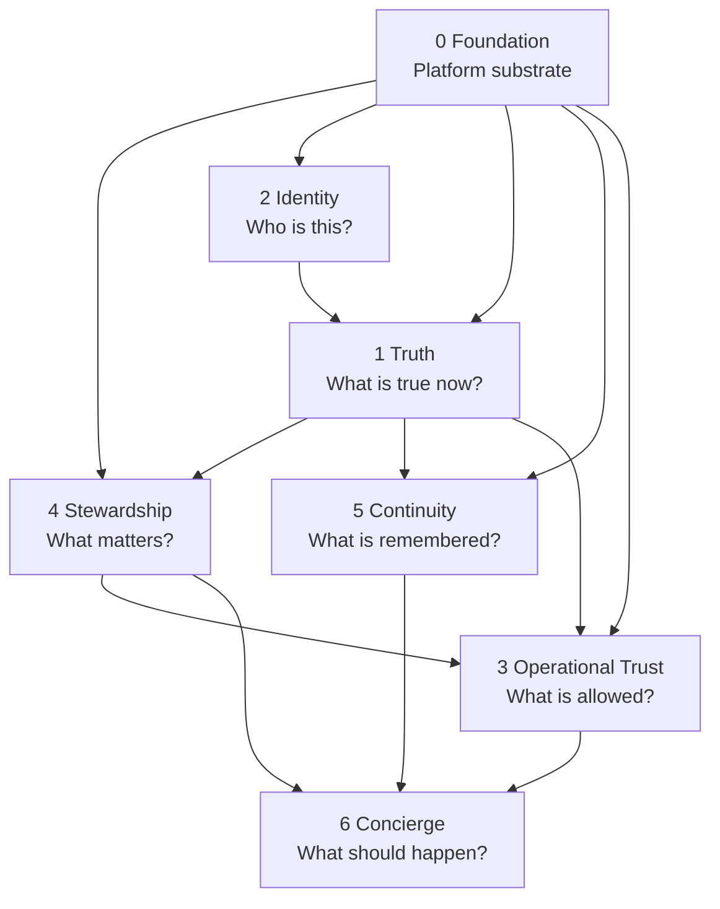

# Homes That Behave Well

> **Document status: Canonical (constitutional) entry point.**
> Canonical authority order: [docs/governance/authority-order.md](docs/governance/authority-order.md).
> Canonical terminology: [docs/models/glossary.md](docs/models/glossary.md).
> Document classification for every file in this repository:
> [docs/governance/document-register.md](docs/governance/document-register.md).

**This repository develops BehavesWell © Core, Home Assistant Edition — the governed implementation of
the six-stage BehavesWell Framework over a Home Assistant Layer 0 Foundation — together with the
architecture, governance, and residential evidence of Homes That Behave Well.**

| Name | What it is |
|---|---|
| **BehavesWell Framework** | The platform-neutral behavioral architecture of six stages: Truth, Identity, Operational Trust, Stewardship, Continuity, Concierge |
| **BehavesWell Core** | The product that applies those six stages over a Layer 0 Foundation. Formerly presented as *HTBW Core* |
| **BehavesWell Core, Home Assistant Edition** | The current and only edition: Home Assistant supplies Layer 0, and BehavesWell Core extends Home Assistant without replacing it |
| **Homes That Behave Well (HTBW)** | The residential research, education, evidence, and lived-outcome ecosystem in which the Framework is tested — including this repository's Reference Home |

Recorded as **DL-153**:
[docs/architecture/adr-behaveswell-framework-foundation-core-edition-and-context-identity.md](docs/architecture/adr-behaveswell-framework-foundation-core-edition-and-context-identity.md).
"HTBW" elsewhere in this repository is established shorthand that predates DL-153 (see the glossary).

**Homes That Behave Well (HTBW) is the constitutional architecture for homes that are calm,
predictable, explainable, and trustworthy.**

This repository defines the framework. It does not execute runtime logic.

---

## ⚠️ Development Status: Not Ready for General Use

Homes That Behave Well is under active development and is not yet ready for general installation,
household testing, or production use.

This repository is public because HTBW is being developed openly, with its architecture, governance,
implementation, testing, and Home Assistant integration evolving together.

You may see installable artifacts such as BehavesWell Core (formerly HTBW Core) in the Home Assistant
Marketplace and the BehavesWell Voice Evidence Home Assistant App (formerly HTBW Voice Evidence). Their presence does not mean HTBW has
reached a public preview or supported release.

Current builds are used only for controlled development and acceptance testing in the HTBW Reference
Home. Interfaces, configuration, persistence, data models, migration behavior, and installation
requirements may change without backward-compatibility guarantees until HTBW reaches an announced
preview milestone.

Please do not install HTBW in a production Home Assistant environment yet.

If you're following the project, the best way to participate right now is to review the architecture,
follow the issues and roadmap, and contribute experience or ideas. We will explicitly announce when
HTBW is ready for broader testing.

Release-readiness vocabulary and current status:
[docs/governance/home-assistant-distribution-and-quality-standard.md](docs/governance/home-assistant-distribution-and-quality-standard.md#11-release-readiness-and-public-development-status).

---

## Use HTBW in Home Assistant

> **Developer/Reference Home testing only. HTBW has not entered public preview. Do not install this
> release in a production Home Assistant environment.**

This repository also ships two separately versioned Home Assistant components:

| Component | Install with | Requires |
|---|---|---|
| **BehavesWell Core, Home Assistant Edition** — Home Assistant integration `custom_components/htbw` (domain `htbw`), shown in Home Assistant as **BehavesWell Core** (formerly HTBW Core) | **Home Assistant Marketplace** (add this repository as an Integration) | Home Assistant 2026.11.0+ |
| **BehavesWell Voice Evidence App** — `apps/htbw_voice_evidence`, optional, experimental; an independent, bounded voice-evidence product that supplies Voiceprint comparison evidence to BehavesWell Core Identity and never resolves a Person (**DL-154**) | **Settings > Apps** (add this repository as an app repository) | Supervisor; amd64 or aarch64 |

The Marketplace installs only the Integration; the app store installs only the App. Neither installs
the other.

<!-- ha-marketplace:exclude-start -->
[](https://my.home-assistant.io/redirect/marketplace_repository/?owner=Homes-That-Behave-Well-LLC&repository=homes_that_behave_well&category=integration)
[](https://my.home-assistant.io/redirect/supervisor_add_addon_repository/?repository_url=https%3A%2F%2Fgithub.com%2FHomes-That-Behave-Well-LLC%2Fhomes_that_behave_well)
<!-- ha-marketplace:exclude-end -->

Installation, setup, supported functionality, use cases, limitations, troubleshooting, and removal:
[docs/user-guide/htbw-in-home-assistant.md](docs/user-guide/htbw-in-home-assistant.md).
Security reporting: [SECURITY.md](SECURITY.md).

---

## The framework

**The BehavesWell Framework consists of six stages: Truth, Identity, Operational Trust, Stewardship,
Continuity, and Concierge. BehavesWell Core applies those six stages over a Layer 0 Foundation
supplied by the implementation platform. Foundation is part of the complete BehavesWell Core
architectural stack, but it is not a seventh stage of the BehavesWell Framework.** (**DL-153**)

| Layer | Stage or substrate | Question |
|---|---|---|
| 6 | **Concierge** | What should happen now? |
| 5 | **Continuity** | What should be remembered, resumed, or transferred? |
| 4 | **Stewardship** | What matters, and what must be cared for? |
| 3 | **Operational Trust** | What is allowed? |
| 2 | **Identity** | Who do we believe this is? |
| 1 | **Truth** | What is actually true now? |
| 0 | **Foundation** — Layer 0, the platform substrate (Home Assistant, in the current edition) | What platform model and native capabilities provide the substrate? |

Two things are deliberately **not** layers:

- **Human Trust is an outcome**, not a component. It emerges when the home behaves predictably and
  explains itself.
- **Behavioral Governance is cross-cutting**, expressed through Operational Trust policy and the
  Decision Trace.

> **Concierge orchestrates. It does not own everything it consumes.**

> **The framework provides governed capability. The household provides the values, priorities,
> consent, and care expectations.** The household declares what matters; **Stewardship** represents
> that declaration and creates governed care obligations. Operational Trust determines what is
> appropriate for a request in a context; it does not author the household's values.

Full definition: [docs/architecture/north-star.md](docs/architecture/north-star.md) and
[docs/architecture/framework.md](docs/architecture/framework.md).

---

## Constitutional refoundation

This repository was refounded on the seven-responsibility framework — now read as the seven-layer
BehavesWell Core stack, Layer 0 Foundation plus six Framework stages (**DL-153**). The refoundation
superseded the earlier **four-service platform model** (Foundation, Asset Intelligence, Voice
Identity, Concierge).

| Previously asserted | Current disposition |
|---|---|
| Foundation owns truth | **Truth** is a first-class fact engine; Foundation defines what a Fact *is* |
| Asset Intelligence answers "what matters" | **Stewardship** answers it; the asset model is Foundation-owned descriptive knowledge |
| Voice Identity is a platform service | **Identity** is the responsibility; voice is one evidence source |
| Room Configuration belongs to Concierge | **Foundation** owns it, as an interaction-definition model |
| No fifth platform service | Superseded — there are seven responsibilities |

Recorded in [docs/governance/decision-ledger.md](docs/governance/decision-ledger.md) and
[docs/architecture/adr-htbw-core-refoundation.md](docs/architecture/adr-htbw-core-refoundation.md).

**Product disposition is stated per product** (**DL-51**). **Asset Intelligence remains a separate
released product** with its own lifecycle, is **not retired**, and **HTBW never requires it to be
installed**. The standalone **Voice Identity** and **Concierge** integrations will **sunset**, while
Identity and Concierge remain first-class HTBW responsibilities. HTBW Core is greenfield and creates
no compatibility requirement for any of them. A household's existing Asset Intelligence data may be
**adopted once** — one-time, authoritative, and terminating (**DL-52**). See
[docs/architecture/greenfield-mandate.md](docs/architecture/greenfield-mandate.md) and
[docs/architecture/adr-product-disposition-and-legacy-adoption.md](docs/architecture/adr-product-disposition-and-legacy-adoption.md).

---

## Dependency direction



Dependencies flow **downward only**. Nothing depends on Concierge. See
[docs/architecture/dependency-view.md](docs/architecture/dependency-view.md).

---

## Principles

Twenty-six principles govern the framework. The ones most often needed:

- **P8** — Evidence is not Truth
- **P9** — An identity assertion is not a contextual truth
- **P13** — Concierge orchestrates; it does not own everything it consumes
- **P14** — Explicit configuration over runtime discovery
- **P15** — Uncertainty must remain visible
- **P16** — The home must explain both its actions and its non-actions
- **P17** — Architecture outlasts technology
- **P19** — Operational Trust is a responsibility; Human Trust is an outcome
- **P21** — Home Assistant First
- **P22** — Connected Storage
- **P23** — Native Experience
- **P25** — The framework is vendor-agnostic
- **P26** — A learned suggestion is not an autonomous policy

Full list: [docs/architecture/principles.md](docs/architecture/principles.md).

---

## Home Assistant position

**Home Assistant First.** Before HTBW builds a capability: does Home Assistant already provide it? If
yes, use it. If partially, extend it natively. If no, build it — and record why.

**Native Experience.** HTBW presents as a native part of Home Assistant. No invented UI standards.

**Vendor-agnostic.** Home Assistant is the first implementation environment, not a constraint on the
architecture.

**Object distinctions are preserved.** A Home Assistant Device, Entity, or Area is never automatically
the same object as an HTBW Asset, Person, Pet, Room, or Service.

See [docs/architecture/home-assistant-boundary.md](docs/architecture/home-assistant-boundary.md).

---

## Reading order

**Start here:**

1. [docs/architecture/north-star.md](docs/architecture/north-star.md) — the constitution
2. [docs/architecture/framework.md](docs/architecture/framework.md) — Layer 0 Foundation and the six Framework stages in full
3. [docs/models/glossary.md](docs/models/glossary.md) — canonical terminology
4. [docs/architecture/principles.md](docs/architecture/principles.md) — P1–P26

**Then:**

5. [docs/architecture/dependency-view.md](docs/architecture/dependency-view.md)
6. [docs/architecture/runtime-sequence.md](docs/architecture/runtime-sequence.md)
7. [docs/contracts/README.md](docs/contracts/README.md)
8. [docs/scenarios/README.md](docs/scenarios/README.md)
**Governing behavior:**

- [docs/architecture/behavioral-governance.md](docs/architecture/behavioral-governance.md)
- [docs/architecture/explainability.md](docs/architecture/explainability.md)
- [docs/architecture/failure-and-degradation.md](docs/architecture/failure-and-degradation.md)
- [docs/architecture/privacy.md](docs/architecture/privacy.md)

**Building it:**

- [docs/architecture/greenfield-mandate.md](docs/architecture/greenfield-mandate.md)
- [docs/architecture/home-assistant-boundary.md](docs/architecture/home-assistant-boundary.md)
- [docs/architecture/connected-storage.md](docs/architecture/connected-storage.md)
- [docs/assessment/assessment-to-platform.md](docs/assessment/assessment-to-platform.md)

**Voice evidence:**

- [docs/architecture/adr-wyoming-compatible-voice-evidence-runtime.md](docs/architecture/adr-wyoming-compatible-voice-evidence-runtime.md)
  — Accepted as **DL-50**. The capability execution host, the Wyoming boundary, and the Voice Evidence
  Provider Principle.

**Governance:**

- [docs/governance/authority-order.md](docs/governance/authority-order.md)
- [docs/governance/decision-ledger.md](docs/governance/decision-ledger.md)
- [docs/governance/open-decision-issue-index.md](docs/governance/open-decision-issue-index.md)
- [docs/governance/document-lifecycle.md](docs/governance/document-lifecycle.md)
- [docs/governance/document-register.md](docs/governance/document-register.md)
- [docs/governance/season-1-architectural-baseline.md](docs/governance/season-1-architectural-baseline.md)
  — point-in-time status snapshot. **Not authority.**

---

## Repository structure

| Path | Contents |
|---|---|
| `custom_components/htbw/` | BehavesWell Core, Home Assistant Edition — the Home Assistant integration, domain `htbw` (household entry with Room subentries) |
| `apps/htbw_voice_evidence/` | The BehavesWell Voice Evidence App, formerly HTBW Voice Evidence (independent product; slug unchanged) (separate runtime; communicates with the Integration only through the #161 contracts; independently versioned) |
| `repository.yaml` | Home Assistant App repository manifest for installing the App through Supervisor |
| `hacs.json` | Home Assistant Marketplace metadata for installing the Integration |
| `.github/` | CI (Marketplace, hassfest, Ruff, mypy, pytest, App lint and build), issue forms, Dependabot |
| `docs/user-guide/` | Household administrator documentation for the Integration and the App |
| `docs/architecture/` | The framework, principles, cross-cutting concerns, and ADRs |
| `docs/models/` | Canonical models for each responsibility, plus the glossary |
| `docs/contracts/` | Explicit boundaries between responsibilities |
| `docs/scenarios/` | Canonical acceptance scenarios |
| `docs/assessment/` | Assessment-to-platform traceability |
| `docs/governance/` | Authority order, document lifecycle, decision ledger, document register, open-decision issue index |
| `docs/philosophy/` | Why the home behaves as it does |
| `docs/patterns/` | Implementation patterns (subordinate to canon) |
| `docs/development/` | Development checklists and guardrails |
| `examples/` | Historical illustrations, retained as evidence |

---

## Related project: BehavesWell Extended Intelligence (formerly Home Steward)

[BehavesWell Extended Intelligence](https://github.com/Homes-That-Behave-Well-LLC/home_steward) —
the product previously named Home Steward (**DL-131**, renamed by **DL-153**) — is a separately governed,
independently installed product for private, local reasoning across explicitly authorized household
sources. It is not a Framework stage and not Stewardship. "Extended" extends authorized reasoning
context, never operational authority. Its repository keeps its current name and identifiers.

HTBW governs what is true, who is engaging, what matters, what context applies, what is permitted,
and what should happen. BehavesWell Extended Intelligence adds retrieval, synthesis, reasoning, and
conversational exploration over household-authorized knowledge without becoming authoritative for
these responsibilities.

It is designed to operate above a household-controlled private-AI platform connected
to HTBW through governed local interfaces.

---

## Local integration development (Issue #201)

The Windows-local `.venv` is for imports, helper checks, linting, and type checking.
The official integration tests run in an external Linux virtual environment in
the existing WSL2 installation, authorized for Issue #201 test execution only.
Neither environment is a Home Assistant installation to run. Do not launch Home
Assistant, create runtime configuration or storage, use Docker, or restart HA from
this repository. `H:` remains the only runtime/deployment environment for this work.
WSL must not access H:, deploy, relocate/clone the repository, reuse the Windows
`.venv`, or perform Git branch/commit/push/reset/clean operations. Git publication
and deployment remain Windows-only.

The test target is **Home Assistant Core 2026.11.0**, using **Python 3.14.2 or
newer in the 3.14 series**. On Windows, select an **x64 Python interpreter**, even
on an ARM64 host; the setup script checks the interpreter's actual wheel platform.
Do not use the former ARM64 dependency overrides or replacement modules.

**Native Windows test blocker:** the genuine 2026.11.0 dependencies install, but
the official pytest plugin imports `homeassistant.runner`, which unconditionally
imports the Unix-only `fcntl` module. Test collection therefore fails on Windows,
including x64 Python. Installing another package or substituting a fake `fcntl`
module is not an accepted fix. Use the authorized Linux test-host procedure below
for the official suite; Windows static/helper checks do not replace it.
The Windows setup script validates dependencies, not test readiness.

[requirements-dev.txt](requirements-dev.txt) pins Core and the official
`pytest-homeassistant` package to the same release. The
[upstream test package](https://github.com/home-assistant/core/tree/2026.11.0/packages/pytest-homeassistant)
replaces `pytest-homeassistant-custom-component`; do not install both.
Dependencies must resolve normally, without `--no-deps` or metadata overrides.
The pytest settings follow the official package's instructions, including disabling
the separate respx plugin so Home Assistant can install its HTTP client alias first.
The integration's form schemas use Probatio, as required by the 2026.11.0 form API.

In PowerShell, from the repository root, supply the full path of an existing
Python interpreter:

```powershell
.\scripts\setup-dev-env.ps1 -PythonPath 'C:\path\to\Python314\python.exe' -Recreate
.\.venv\Scripts\python.exe -m pip check
.\.venv\Scripts\python.exe -m ruff check custom_components\htbw tests
.\.venv\Scripts\python.exe -m ruff format --check custom_components\htbw tests
.\.venv\Scripts\python.exe -m mypy custom_components\htbw
```

`-Recreate` deletes only the repository-local `.venv`, including packages left by
the abandoned setup. The script stops on installation or dependency-check failure;
successful dependency installation alone does not establish passing tests. Repeat
the clean setup and checks when validating reproducibility.

### Official suite on the authorized WSL2 test host

Use the existing Ubuntu WSL2 distribution and Python 3.14.2+ (3.14.x). The mounted
working tree is the same authoritative Windows repository, not a second clone.
Keep the Linux environment, pytest cache, temporary files, and logs outside it:

```bash
python3.14 -m venv "$HOME/.venvs/htbw-ha-tests"
source "$HOME/.venvs/htbw-ha-tests/bin/activate"
cd /mnt/c/HomesPlatformRepos/homes_that_behave_well
python -m pip install -r requirements-dev.txt
python -m pip check
python -m pip freeze --all > "$HOME/.venvs/htbw-ha-tests-freeze.txt"
test_artifacts="$HOME/.cache/htbw-issue201"
mkdir -p "$test_artifacts"
PYTHONDONTWRITEBYTECODE=1 python -m pytest tests -q \
  -o cache_dir="$test_artifacts/pytest-cache" \
  --basetemp="$test_artifacts/pytest-tmp" \
  --junitxml="$test_artifacts/pytest.xml"
```

The official HA fixtures exercise integration behavior with their in-memory
storage fixture; this does not authorize running `hass`, `python -m homeassistant`,
a database, or an HA service. Do not weaken or replace the fixtures to get a pass.
Use Windows tools for any source edits, inspect `git diff --check` and line-ending
changes, then rerun the complete Linux suite and Windows checks before publication.

After both Linux pytest and Windows checks pass, commit and push before running the authorized
[PowerShell deployment script](scripts/deploy-to-ha.ps1), first with
`-Commit <full-tested-commit-hash> -DryRun`, then with the same `-Commit`
without `-DryRun`. The script rejects a dirty tree, a commit differing from HEAD
or origin/main, unexpected runtime files, linked paths, and an H: drive not mapped
to the authorized HA-DEV configuration share. Source and destination cannot be
overridden. It compares every deployed runtime file's SHA256 with the checked
Windows source bytes; Git's CRLF checkout conversion is not a content change.
Deploy only `custom_components\htbw` to `H:\custom_components\htbw`, verify all
deployed file hashes, then stop. Passing automated tests and matching files do not
establish Reference Home runtime or household acceptance; that remains a separate
owner validation.

### Configuration hierarchy (Issue #162)

HTBW is configured as **one household HTBW entry** with each HTBW Room as a native
**Room subentry** beneath it.

- **Household entry.** This is the Integration configuration. It holds only
  household-scoped settings: "Retain Enrollment Recordings" (its options flow) and the
  Voice Evidence App connection provisioned by Supervisor Discovery.
- **Rooms.** Add a Room with **Add Room** on the HTBW entry. Change a Room's interaction
  functions by reconfiguring that Room.

The #201 per-Room config entries migrate automatically and losslessly into Room
subentries on first start of version 0.2.0. The first entry is converted in place, and
any later ones are copied, verified, and then retired. Migration does not repeat.

### Room interaction implementation boundary

Native selectors for the four functions allow multiple selections. Each selection is persisted
as its own atomic record; the stored shape for existing single selections is
unchanged. The Foundation query is
`get_room_interaction_assignments(hass, room_id, function)`: it returns **all**
participating records with a per-reference `resolved` or `missing` result. An
empty list means no participating assignment is configured. No list order implies
priority, selection, fallback, or fan-out. This replaces the earlier singular
Python helper that silently selected the first record; there are no production
Concierge consumers in this slice.

The Room reconfigure form preserves unchanged timestamps and nonparticipating records. An explicit
selection can reactivate an excluded record; an omitted participating assignment
is removed. The form includes native entity and device selectors for input, output,
and remote, and a device selector for interface, following specification section
18.1. It uses four expanded native HA sections, one per function.
Within each section, selectors are labelled **Entities** then **Devices** where
supported; **Interface** has **Devices** only, as specified by section 18.1.
Section titles and field labels use HA's `config_subentries.room.step.reconfigure.sections`
translations.
There are no detached device fields or additional functions. Native selectors
provide their own Add entity/Add device controls. The nested form submission is
projected onto the existing assignment builder; persisted record keys, timestamps,
participation, and retrieval are unchanged by the move to Room subentries.
Device selections remain empty unless explicitly selected.
A stored unsupported function/reference-type combination is not
silently discarded: the form reports the problem and refuses the save.

Disabled but still-existing native objects are not missing. Repairs are scoped
to each participating reference, reconcile removal/restoration and native-ID
renames without remapping, and do not treat an `unavailable` state as a defect.
Diagnostics redact Room, config-entry, and native-reference identifiers using
Home Assistant's standard helper. The official integration tests and a new exact-version Owner retest are required
before acceptance.

---

## Document status

**Every Markdown file in this repository carries a status banner.** Canonical documents define the
framework; historical documents are retained as architectural evidence and are not current authority.

When documents disagree, [docs/governance/authority-order.md](docs/governance/authority-order.md)
decides. Every file's disposition is recorded in
[docs/governance/document-register.md](docs/governance/document-register.md).

---

## Open decisions

**Seventy-six decisions are deliberately unresolved**, recorded as **OD-01** through **OD-87** in
[docs/governance/decision-ledger.md](docs/governance/decision-ledger.md) — including the Home Assistant
representation strategy, Truth Fact confidence representation, identity-confidence thresholds,
Decision Trace retention, the Stewardship obligation lifecycle, legacy adoption scope, vocabulary
change and term-withdrawal consequences, and identity artifact invalidation. Eleven of
the eighty-seven identifiers are closed or resolved and are preserved rather than deleted.

**A deliberately open decision is not a gap.** Recording it honestly is better than inventing an answer
the household has not chosen.

> **GitHub issues are the authoritative source for the current status, remaining questions,
> dependencies, and closure evidence of each open decision. This repository remains authoritative for
> accepted architecture.** The identifier-to-issue mapping is
> [docs/governance/open-decision-issue-index.md](docs/governance/open-decision-issue-index.md).

---

## The governance test

The documentation in this repository must be able to answer, without contradiction:

What exists? · What participates? · What is exposed? · What do residents call it here? · Who is this? ·
What is actually true? · What matters and must be cared for? · What should be remembered, resumed, or
transferred? · What is allowed? · What should happen now? · Why did it happen? · Why did it not happen? ·
Which policy or fact took priority? · Where is each responsibility defined? · Which decisions remain
open?

---

## How downstream repositories use this

Asset Intelligence remains a **separate released product**; the standalone Voice Identity and
Concierge integrations will **sunset**, with their responsibilities first-class inside HTBW
(**DL-51**). This repository grounds their architectural decisions and records the discoveries made in
building them. It does **not** impose a compatibility requirement on them, and it contains no runtime
code.

When a pattern evolves during implementation, it should be reflected here so the framework stays
coherent — subject to
[docs/governance/authority-order.md](docs/governance/authority-order.md), in which implementation is
rank 6 and does not override the framework.

---

## Design goal

This is not conventional automation.

It is a structured, explainable decision framework for the home — one that can always say what it
believed, what it did, what it did not do, and why.


The goal is not merely to automate devices.

The goal is to create a home that understands context, behaves predictably, and explains itself clearly.

---

## Names and notices

*BehavesWell © Core* and *BehavesWell © Extended Intelligence* are the Owner's formal branded
notations for the products named **BehavesWell Core** and **BehavesWell Extended Intelligence**. They are
not legal notices, and no trademark or other legal status is asserted by them. Technical identifiers
(`htbw`, `htbw_voice_evidence`, and the others listed in DL-153) never carry them.

© 2026 Homes That Behave Well LLC
