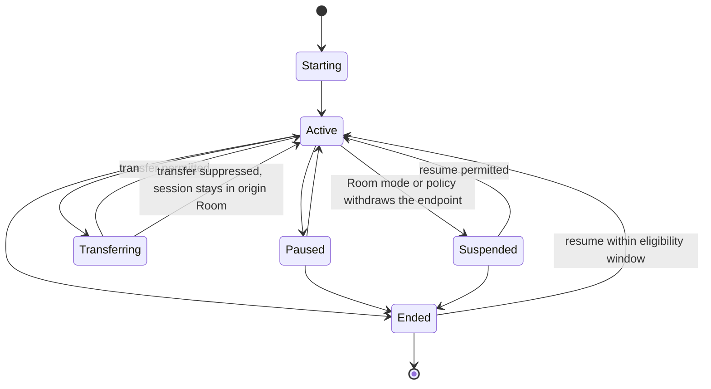

# Experience and Session Model

> **Document status: Canonical model.**
> Terminology: [glossary.md](glossary.md). Owning responsibility: **Continuity**.
> Contract: [../contracts/continuity-contract.md](../contracts/continuity-contract.md)
> Foundation defines the object types. Concierge consumes this model to coordinate; coordination is a
> consumer relationship, not co-ownership.

---

## Purpose

Separate the *kind of thing happening* (Experience) from the *specific instance running* (Session),
so that transfer, resume, suppression, conflict, and explanation have precise subjects.

## Question answered

*What is running, who owns it, where is it, and what may happen to it?*

---

## Experience

An Experience is a coherent household-facing activity that can be started, transferred, resumed,
suppressed, or ended.

Representative classes:

| Class | Examples |
|---|---|
| Media | Music, video, podcast, radio |
| Informational | Briefing, status summary, knowledge answer |
| Environmental | Comfort scene, lighting scene, shade scene |
| Routine | Good Night, Good Morning, Away, Arrival |
| Conversational | An active conversation with the home |
| Care | A medication reminder flow, a maintenance walkthrough |

An Experience defines what endpoints it needs (for example, a music endpoint) and what Room
Configuration must supply for it to be available in a Room.

---

## Session

A Session is a specific running instance of an Experience.

| Element | Purpose |
|---|---|
| Session identity | Distinguishes this instance |
| Experience class | What kind of thing this is |
| Owner | The Person whose session it is, where applicable |
| Participants | Other people currently engaged |
| Origin Room | Where it started |
| Current Room | Where it is now |
| Started at | Lifecycle timestamp |
| State | Starting, active, paused, transferring, suspended, ended |
| Transfer intent | Follow-Me, ask-before-transfer, never-transfer |
| Resume eligibility | Whether and until when it may be resumed |
| Blocking state | Why a transfer or resume is currently not eligible, with attribution |

A Room may host at most one *primary* experience per endpoint class at a time; additional sessions
constitute a conflict to be resolved. **Whether a Room permits concurrent sessions of the same class
is resolved as DL-102**, see *Session Concurrency Policy* below.

---

## Lifecycle

**A suppressed transfer is not a failure state.** The session remains active in its origin Room, and
the suppression is recorded with a reason.

---

## Ownership and participation

- A Session has an owner where it was started by or on behalf of a person.
- A Room experience may have no personal owner (for example, a shared scene).
- Participants may join without becoming owners.
- Ending or modifying another person's session requires authority granted by Operational Trust.

---

## Conflict subjects

Precise conflict statements require both concepts:

| Statement | Subject |
|---|---|
| "Music is already playing in the Kitchen" | An active **Session** in that Room |
| "Tom's Jazz session wants to follow him" | A **Session** with transfer intent |
| "Nighttime mode prohibits incoming media" | A Room **mode** versus an **Experience** class |
| "David's arrival must not replace Tom's session" | Two **Sessions**, one Room |

---

## Session Concurrency Policy (DL-102)

**Resolves OD-27 in full.** Governs when more than one Session may be Active at once; does **not**
decide whether two Sessions that conflict should merge (**OD-24**, unaffected).

### The governing unit is the endpoint class, not Session or Experience class

Concurrency is governed by **endpoint-class contention**, not by whether two Sessions share the same
Experience class. Two Sessions requiring **different** endpoint classes (Room Configuration's
existing, extensible category — music, video, announcement, conversation, and others) never conflict,
regardless of class: two music Sessions on two independent personal endpoints coexist exactly as
readily as a music Session and a video Session on two independent Room endpoints. Two Sessions
requiring the **same** endpoint class conflict regardless of whether one is "personal" and the other
"Room," or whether both are the same Experience class. **Personal-versus-Room remains meaningful for
ownership and privacy (disclosure) semantics — it does not itself determine contention.**

This refines, rather than selects wholesale, the original Option A ("personal sessions concurrent,
room experiences exclusive"): that outcome is usually *true in practice*, because personal endpoints
(headphones) are typically independent per Person while Room endpoints are typically shared — but the
*rule* is endpoint-class contention, which also explains the cross-class case (a Personal Session on
headphones and a Room Experience on the Room speaker, in the same Room, coexist freely) and the
Room-versus-Room case (two Room Experiences on two independently capable Room endpoints coexist; two
Room Experiences contending for the Room's one capable endpoint of that class do not).

### Owner and participant

A Session has at most one owner and any number of participants (both already-accepted fields). **A
second Person present in a Room does not become a participant, a competing owner, or a second Session
merely by presence or by co-occupancy.** Becoming a participant in an existing Session requires an
explicit request Operational Trust evaluates (the same authority already required to end or modify
another person's session) — never inferred from mere Room co-presence. Shared listening — two people,
one active Session — is therefore a **participant** fact, not a concurrency conflict and not a merge
question: the Session count remains one.

### Second-session / incoming-request outcome

**The incumbent Session is never silently displaced, ended, or merged.** Displacement remains
Operational Trust's authority, exactly as already accepted (`multi-person-conflict.md`, Rule 3:
*"Sessions have owners, and displacement requires authority"*); Continuity reports the contention and
never grants itself displacement authority merely because it detects it.

Two distinct, already-named outcomes apply depending on how the incoming request arose — these are
**not** the same state and must not be conflated:

- **A transferring Session arrives at a Room where the contended endpoint class is already held** (for
  example, a Follow-Me transfer): the existing Transfer lifecycle already names this outcome —
  *"a suppressed transfer is not a failure state. The session remains active in its origin Room, and
  the suppression is recorded with a reason"* (unchanged, reused as-is). `multi-person-conflict.md`
  Scenario 5 is the already-accepted worked example: Tom's incoming transfer is suppressed, David's
  incumbent session is untouched, and Concierge offers Tom an alternative Room.
- **A freshly requested Session (not a transfer) contends for an already-held endpoint class**: this
  reuses the model's own existing Failure Behavior entry, unchanged — *"two sessions claim one
  endpoint — report a conflict; do not resolve inside this model."* The new Session does not start;
  it is not "suppressed" (that term is specific to the Transfer lifecycle edge above) and it is not
  silently denied without a reason.

In both cases, Concierge — per its existing conflict-resolution role (*"Concierge resolves conflicts
among permitted outcomes. It does not grant itself authority to displace a session,"*
`multi-person-conflict.md` Scenario 1) — offers an alternative or asks, using Operational Trust's
already-existing Explicit/Assisted/Autonomous mode framework (`continuity.md`, *"Which mode applies is
determined by Operational Trust, not by Continuity"*); no new mode mechanism is created. **No queue or
pending-session state exists or is created here** — "queued" does not appear anywhere in the current
Session lifecycle or in `continuity.md`/`continuity-contract.md`, and is not adopted as an outcome.

### What OD-27 exports to OD-24

OD-27 supplies OD-24 with the **facts** a merge decision needs, and decides no part of the merge
itself: that two Sessions exist, the endpoint class they both require, their respective owners and
participants, and whether Operational Trust has (or has not) authorized displacement. **OD-24 alone**
decides whether, how, and under whose ownership a merge occurs, how preferences resolve in a merged
Session, and separation behavior.

### Grouped playback and duplicate playback

**Grouped/synchronized playback across the constituent Physical Rooms of one Merged Room requires no
new architecture.** A Merged Room behaves as one Room (**DL-13**, unchanged): one Session, one
`Current Room` (the Merged Room), rendered across whatever endpoints Room Configuration exposes
beneath it — not a special "grouped" concept, not a second Session, not duplication. Movement between
constituent Physical Rooms of one Merged Room remains neither Transfer nor Resume (**DL-13**, no Room
Context changed). **Grouped playback deliberately spanning separate, non-merged Rooms is not currently
modeled** and is not decided here; a household wanting this already has the Merged Room mechanism
available, and a from-scratch cross-Room grouped-session concept remains a genuine, narrow, explicitly
deferred residual — not a blocking gap, and not invented in its absence.

**Duplicate playback — the precise, bounded guarantee.** A Session's `Current Room` is a **single**
field: HTBW's own semantic record never represents one Session as simultaneously Active with two
different `Current Room` values, and a Transfer updates that one field rather than creating a second
representation. **This is a semantic/representational guarantee only.** It is **not** a guarantee that
the underlying provider actually stopped rendering at the origin — provider session-state handoff
(pause, stop, join, synchronize) remains explicitly outside HTBW's governed model (**P21**, **DL-46**),
exactly as `continuity-use-cases.md` Use Case 3 already states: *"The provider's session cannot be
handed off → Unresolved — provider session semantics are `N` → Must not: Claim a governed handoff
protocol exists."* Where Truth/media-player evidence shows the origin endpoint still rendering after a
declared Transfer, this is an honest, representable **discrepancy** between HTBW's semantic state and
physical reality — never silently hidden, never asserted away as resolved.

### Volume

Room-scoped TTS/music/duck volume remains Continuity's existing **remembered experience state**
(`continuity.md`), unaffected by this decision and not independently contended: because an endpoint
class hosts at most one primary experience at a time, there is naturally only one active volume
context for it, with no separate allocation rule required.

### Household configuration

**Not required as the primary mechanism.** Whether two Sessions contend for the same endpoint class is
a structural, resource-capability fact — not a preference — and is not made configurable. A household
*may* still configure **which mode** (Explicit/Assisted/Autonomous) resolves a genuine conflict,
reusing Operational Trust's existing mode framework unchanged; this is not a new per-class concurrency
configuration surface.

### Provider and Home Assistant boundary

Provider-specific play/pause/resume/join/group/queue/crossfade/handoff/session-token mechanics remain
the provider's own (**P21**, **DL-46**); none is decided here. Home Assistant media player state
remains authoritative for native per-device playback state where accepted; Home Assistant supplies no
native session-concurrency concept, consistent with this issue's own Home Assistant First review.

### Decision Trace and retention

Decision Trace already requires every session-state transition resulting from a decision — especially
a suppression or displacement refusal — to carry its Decision Trace reference; this decision extends
the same discipline to concurrency outcomes (which endpoint class was contended, which Session held
it, participants, displacement-authorization result, and whether facts were handed to OD-24) — no new
trace mechanism. Retention of this history follows the existing Continuity/**DL-47** pattern; floor,
ceiling, and duration remain **OD-26**'s own, not decided here.

---

## Consumes

- Foundation Experience and Room definitions
- Room Configuration experience endpoints
- Identity assertions for ownership attribution
- Truth facts for Room state and availability

## Provides

- Session state to Concierge for conflict resolution
- Transfer and resume eligibility with blocking attribution
- Experience history and resume candidates

## Explicit non-responsibilities

This model does **not** decide whether a session may move, may be displaced, or may start. Those are
Operational Trust policy questions resolved by Concierge.

---

## Failure behavior

| Condition | Behavior |
|---|---|
| Endpoint disappears mid-session | Session becomes Suspended with a reason; do not silently end it |
| Owner identity becomes unresolved | Session retains its recorded owner; do not reassign it |
| Platform restart | Do not fabricate an Active session; re-establish only what is verifiable |
| Two sessions claim one endpoint | Report a conflict; do not resolve inside this model |

## Privacy considerations

Session content and history reveal personal habits. Visibility follows Operational Trust policy;
guests do not see residents' session history.

## Explainability requirements

Every session state transition that resulted from a decision — especially a suppression or a refusal
to displace — carries the Decision Trace reference that caused it.

---

## Representative scenarios

- [../scenarios/follow-me-media.md](../scenarios/follow-me-media.md)
- [../scenarios/multi-person-conflict.md](../scenarios/multi-person-conflict.md)

## Open decisions

| ID | Question |
|---|---|
| OD-24 | Session-merging algorithm |
| OD-25 | Resume eligibility window defaults per experience class |
| OD-27 | **Closed — DL-102.** Concurrency is governed by endpoint-class contention, not Session/Experience class; second-session/incoming-request outcomes (suppressed transfer vs. conflict-reported-not-started), participant join, grouped playback within/across Merged Rooms, and the duplicate-playback semantic-only guarantee are each stated; OD-24 retains merge policy |

## Related documents

- [continuity.md](continuity.md)
- [decision-trace.md](decision-trace.md)
- [../architecture/behavioral-governance.md](../architecture/behavioral-governance.md)
