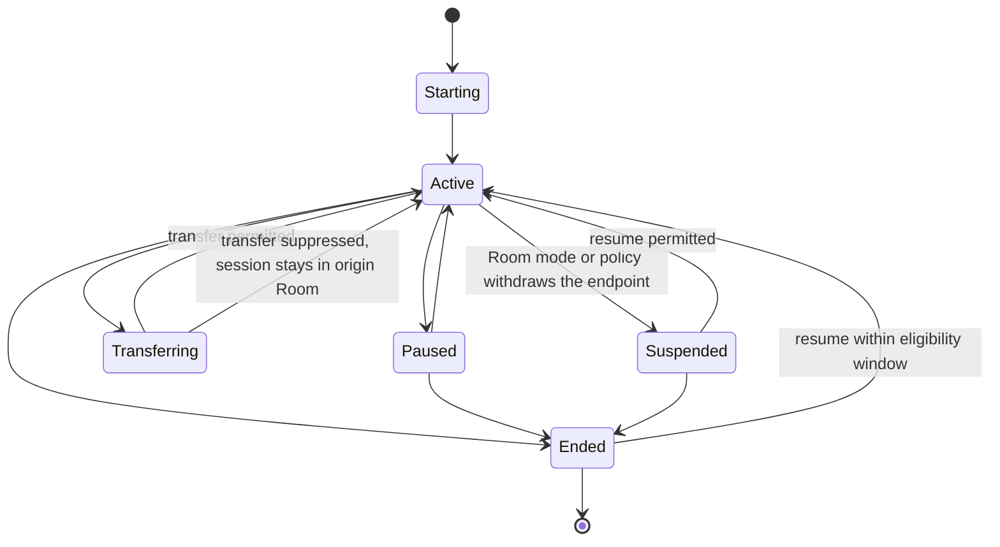

# Experience and Session Model

> **Document status: Canonical model.**
> Terminology: [glossary.md](glossary.md). Owning responsibility: **Continuity**.
> Contract: [../contracts/continuity-contract.md](../contracts/continuity-contract.md)
> Foundation defines the object types. Concierge consumes this model to coordinate; coordination is a
> consumer relationship, not co-ownership.

---

## Purpose

Separate the *kind of thing happening* (Experience) from the *specific instance running* (Session),
so that transfer, resume, suppression, conflict, and explanation have precise subjects.

## Question answered

*What is running, who owns it, where is it, and what may happen to it?*

---

## Experience

An Experience is a coherent household-facing activity that can be started, transferred, resumed,
suppressed, or ended.

Representative classes:

| Class | Examples |
|---|---|
| Media | Music, video, podcast, radio |
| Informational | Briefing, status summary, knowledge answer |
| Environmental | Comfort scene, lighting scene, shade scene |
| Routine | Good Night, Good Morning, Away, Arrival |
| Conversational | An active conversation with the home |
| Care | A medication reminder flow, a maintenance walkthrough |

An Experience defines what endpoints it needs (for example, a music endpoint) and what Room
Configuration must supply for it to be available in a Room.

---

## Session

A Session is a specific running instance of an Experience.

| Element | Purpose |
|---|---|
| Session identity | Distinguishes this instance |
| Experience class | What kind of thing this is |
| Owner | The Person whose session it is, where applicable |
| Participants | Other people currently engaged |
| Origin Room | Where it started |
| Current Room | Where it is now |
| Started at | Lifecycle timestamp |
| State | Starting, active, paused, transferring, suspended, ended |
| Transfer intent | Follow-Me, ask-before-transfer, never-transfer |
| Resume eligibility | Lifecycle state of a pending Follow-Me intent or a resumable ended Session — **Current, Pending, Settled, Cancelled, Superseded, Blocked** (resolved — DL-128); never a time-window value |
| Blocking state | Why a transfer or resume is currently not eligible, with attribution |

A Room may host at most one *primary* experience per endpoint class at a time; additional sessions
constitute a conflict to be resolved. **Whether a Room permits concurrent sessions of the same class
is resolved as DL-102**, see *Session Concurrency Policy* below.

### Transfer intent is mutable within the same Session (resolved — DL-127)

**Transfer intent is an ordinary, mutable Session element, governed by the same Current-Projection-
plus-Change-Record pattern as every other Session field (State, Resume eligibility, and so on) — not
fixed at Session start.** A resident may explicitly shift it mid-session:

- *"Leave it here"* — a Person-following Session (Transfer intent: Follow-Me) becomes Room-anchored: a
  Change Record sets Transfer intent to **never-transfer**. The Session stops following the Person into
  future Rooms; it does not clone or continue elsewhere merely because the Person later leaves.
- *"Take it with me"* — a Room-anchored Session (Transfer intent: never-transfer) becomes
  Person-following: a Change Record sets Transfer intent to **Follow-Me**. No destination needs to be
  known at that moment; wherever Identity later sufficiently resolves the Person, Follow-Me eligibility
  (above) governs continuation there.

**Neither transition changes the Session's own identity.** No successor Session is created, and no
historical meaning is rewritten — the Session's prior Transfer-intent value remains reconstructable
exactly as any other Change Record history is. An **explicit Room-targeted request** ("play music in
my Office") establishes a Session with Transfer intent never-transfer by default, because Follow-Me
was never invoked; the Person subsequently leaving that Room is never, by itself, reason to transfer,
follow, or end the Session — occupancy alone is not a termination mechanism; intent provenance governs.

### Pending Follow-Me intent is lifecycle-bound, never time-bound (resolved — DL-128)

An explicit "follow me" sets Transfer intent to Follow-Me **and** establishes a pending Follow-Me
intent, carried in the Resume-eligibility field's lifecycle state: **Current** (an active, eligible
experience exists) → **Pending** (the explicit request established intent) → **Settled** (successfully
continued somewhere) | **Cancelled** (explicitly withdrawn) | **Superseded** (a newer Follow-Me request
for a different active experience replaced it) | **Blocked** (a governed condition currently prevents
settlement, attribution preserved via the existing Blocking-state field, remains Pending). Elapsed
time alone is never a reason to drop a Pending intent — there is no "Expired" state for Follow-Me.

**One pending Follow-Me intent exists per Person**, by direct analogy to this model's own one-owner-
per-Session rule (**DL-102**): establishing a new Follow-Me request for a different active experience
**supersedes** any still-Pending prior intent for that Person, reusing the Governed-Reference
Supersedes/Superseded-by pattern already used elsewhere (for example, Communications) rather than
inventing a new one. A superseded intent is retained only as ordinary history — never queued, never
re-offered, never surfaced as a backlog of unfinished experiences.

**Disambiguation.** An unqualified "follow me" resolves without asking where exactly one current,
active, eligible experience exists; Concierge asks which rather than guessing where more than one
exists; where none exists, Follow-Me establishes nothing, and Continuity never searches Experience
History or provider history to manufacture a candidate.

**Destination may be unresolved or explicit at initiation — one representation, not two.** "Follow me
with the music" leaves the destination to resolve later (through Identity evidence, or an explicit
later interaction such as "resume here"). "Follow me with the music to the Den" supplies the
destination immediately as current-intent/target-context evidence, resolved through the ordinary Room
Context mechanism — never requiring a later "resume here" merely to (re)identify a destination already
named. **An explicit destination is evidence of where the Person wants the experience to continue,
never evidence of where the Person currently is** — never an Identity-derived presence assertion, and
never a bypass of Operational Trust, capability, availability, provider, or privacy governance.

**Resuming an ended Session is a separate, explicit, on-demand request — never a proactive offer.**
Its availability is already fully governed by **DL-122**'s Experience History retention (Room
Setup/Person Setup configured) plus **DL-46**'s provider-owned content/position availability; no
additional, HTBW-side, per-experience-class duration exists or is required.

---

## Lifecycle

**A suppressed transfer is not a failure state.** The session remains active in its origin Room, and
the suppression is recorded with a reason.

---

## Ownership and participation

- A Session has an owner where it was started by or on behalf of a person.
- A Room experience may have no personal owner (for example, a shared scene).
- Participants may join without becoming owners.
- Ending or modifying another person's session requires authority granted by Operational Trust.

---

## Conflict subjects

Precise conflict statements require both concepts:

| Statement | Subject |
|---|---|
| "Music is already playing in the Kitchen" | An active **Session** in that Room |
| "Tom's Jazz session wants to follow him" | A **Session** with transfer intent |
| "Nighttime mode prohibits incoming media" | A Room **mode** versus an **Experience** class |
| "David's arrival must not replace Tom's session" | Two **Sessions**, one Room |

---

## Session Concurrency Policy (DL-102)

**Resolves OD-27 in full.** Governs when more than one Session may be Active at once; does **not**
decide whether two Sessions that conflict should merge (**OD-24**, unaffected).

### The governing unit is the endpoint class, not Session or Experience class

Concurrency is governed by **endpoint-class contention**, not by whether two Sessions share the same
Experience class. Two Sessions requiring **different** endpoint classes (Room Configuration's
existing, extensible category — music, video, announcement, conversation, and others) never conflict,
regardless of class: two music Sessions on two independent personal endpoints coexist exactly as
readily as a music Session and a video Session on two independent Room endpoints. Two Sessions
requiring the **same** endpoint class conflict regardless of whether one is "personal" and the other
"Room," or whether both are the same Experience class. **Personal-versus-Room remains meaningful for
ownership and privacy (disclosure) semantics — it does not itself determine contention.**

This refines, rather than selects wholesale, the original Option A ("personal sessions concurrent,
room experiences exclusive"): that outcome is usually *true in practice*, because personal endpoints
(headphones) are typically independent per Person while Room endpoints are typically shared — but the
*rule* is endpoint-class contention, which also explains the cross-class case (a Personal Session on
headphones and a Room Experience on the Room speaker, in the same Room, coexist freely) and the
Room-versus-Room case (two Room Experiences on two independently capable Room endpoints coexist; two
Room Experiences contending for the Room's one capable endpoint of that class do not).

### Owner and participant

A Session has at most one owner and any number of participants (both already-accepted fields). **A
second Person present in a Room does not become a participant, a competing owner, or a second Session
merely by presence or by co-occupancy.** Becoming a participant in an existing Session requires an
explicit request Operational Trust evaluates (the same authority already required to end or modify
another person's session) — never inferred from mere Room co-presence. Shared listening — two people,
one active Session — is therefore a **participant** fact, not a concurrency conflict and not a merge
question: the Session count remains one.

### Second-session / incoming-request outcome

**The incumbent Session is never silently displaced, ended, or merged.** Displacement remains
Operational Trust's authority, exactly as already accepted (`multi-person-conflict.md`, Rule 3:
*"Sessions have owners, and displacement requires authority"*); Continuity reports the contention and
never grants itself displacement authority merely because it detects it.

Two distinct, already-named outcomes apply depending on how the incoming request arose — these are
**not** the same state and must not be conflated:

- **A transferring Session arrives at a Room where the contended endpoint class is already held** (for
  example, a Follow-Me transfer): the existing Transfer lifecycle already names this outcome —
  *"a suppressed transfer is not a failure state. The session remains active in its origin Room, and
  the suppression is recorded with a reason"* (unchanged, reused as-is). `multi-person-conflict.md`
  Scenario 5 is the already-accepted worked example: Tom's incoming transfer is suppressed, David's
  incumbent session is untouched, and Concierge offers Tom an alternative Room.
- **A freshly requested Session (not a transfer) contends for an already-held endpoint class**: this
  reuses the model's own existing Failure Behavior entry, unchanged — *"two sessions claim one
  endpoint — report a conflict; do not resolve inside this model."* The new Session does not start;
  it is not "suppressed" (that term is specific to the Transfer lifecycle edge above) and it is not
  silently denied without a reason.

In both cases, Concierge — per its existing conflict-resolution role (*"Concierge resolves conflicts
among permitted outcomes. It does not grant itself authority to displace a session,"*
`multi-person-conflict.md` Scenario 1) — offers an alternative or asks, using Operational Trust's
already-existing Explicit/Assisted/Autonomous mode framework (`continuity.md`, *"Which mode applies is
determined by Operational Trust, not by Continuity"*); no new mode mechanism is created. **No queue or
pending-session state exists or is created here** — "queued" does not appear anywhere in the current
Session lifecycle or in `continuity.md`/`continuity-contract.md`, and is not adopted as an outcome.

### What OD-27 exports to OD-24

OD-27 supplies OD-24 with the **facts** a merge decision needs, and decides no part of the merge
itself: that two Sessions exist, the endpoint class they both require, their respective owners and
participants, and whether Operational Trust has (or has not) authorized displacement.

### No Session Merge construct exists (resolved — DL-127)

**OD-24 resolved by retiring "merge" as an architectural noun for Session concurrency, rather than by
building merge mechanics.** HTBW never combines two Sessions into one synthetic merged Session. Every
scenario the historical issue language called "merge" is already covered by a distinct, already-named
mechanism: **participant join** (an explicit Operational-Trust-evaluated act, above); **displacement**
(Operational Trust's own authority, `multi-person-conflict.md` Rule 3); **transfer suppression** (the
existing Transfer lifecycle's "suppressed transfer" outcome, above); **grouped playback within one
Merged Room** (below, DL-13 unchanged); and **multi-Room target expansion** (below). Competing intent
is resolved by one of these outcomes — never by inventing a combined-ownership Session.

### Multi-Room target expansion creates no Floor/House-owned Session tier (resolved — DL-127)

A spatial phrase such as *"throughout the house"* or *"upstairs"* is **Concierge/vocabulary target
resolution** — `contextual-vocabulary.md`'s Home-scoped term resolution and/or native Home Assistant
multi-Area/Floor targeting — producing **N independently targeted Rooms**, directly reusing **DL-125**'s
own "Floor-targeted fan-out, each entity's own scope evaluated independently" precedent. Each resulting
Room receives its own ordinary per-Room Session, independently governed; a later Room-specific command
(*"turn the music down in the Den"*) affects only that Room's own Session, never reaching into the
other Rooms the earlier broad command also targeted. The earlier broad command remains Decision Trace
provenance for why each Room's Session began — it does not bind the resulting per-Room Sessions into
one Session, and no Floor-owned, House-owned, or "everywhere"-owned Session-ownership tier is created.
**Target resolution and value resolution stay separate** (**DL-124**, **DL-126**, unchanged): once a
target expression resolves to Rooms, each Room resolves its own applicable value under existing
Continuity rules unless the request itself supplies an explicit value, applied per targeted Room.

### Remembered-value observation is a separate governed activity (resolved — DL-127)

A command causing a Room's observable state to change (for example, a multi-Room volume command
changing the Den from 20% to 30%) is one governed activity. An **independent** remembered-value
observer separately, later, evaluates whether the new state qualifies as stable under **DL-124**'s own
dwell/attribution gating and records it if so — unchanged, not reopened. Causation never merges the
two activities into one Session, and the causing Session/command is never recorded as the owner of the
resulting remembered-value record.

### Grouped playback and duplicate playback

**Grouped/synchronized playback across the constituent Physical Rooms of one Merged Room requires no
new architecture.** A Merged Room behaves as one Room (**DL-13**, unchanged): one Session, one
`Current Room` (the Merged Room), rendered across whatever endpoints Room Configuration exposes
beneath it — not a special "grouped" concept, not a second Session, not duplication. Movement between
constituent Physical Rooms of one Merged Room remains neither Transfer nor Resume (**DL-13**, no Room
Context changed). **Grouped playback deliberately spanning separate, non-merged Rooms is not currently
modeled** and is not decided here; a household wanting this already has the Merged Room mechanism
available, and a from-scratch cross-Room grouped-session concept remains a genuine, narrow, explicitly
deferred residual — not a blocking gap, and not invented in its absence. **This remains distinct from
multi-Room target expansion (above, DL-127): expansion produces N independent per-Room Sessions from
one broad command, never one synchronized cross-Room session — the two must not be conflated.**

**Duplicate playback — the precise, bounded guarantee.** A Session's `Current Room` is a **single**
field: HTBW's own semantic record never represents one Session as simultaneously Active with two
different `Current Room` values, and a Transfer updates that one field rather than creating a second
representation. **This is a semantic/representational guarantee only.** It is **not** a guarantee that
the underlying provider actually stopped rendering at the origin — provider session-state handoff
(pause, stop, join, synchronize) remains explicitly outside HTBW's governed model (**P21**, **DL-46**),
exactly as `continuity-use-cases.md` Use Case 3 already states: *"The provider's session cannot be
handed off → Unresolved — provider session semantics are `N` → Must not: Claim a governed handoff
protocol exists."* Where Truth/media-player evidence shows the origin endpoint still rendering after a
declared Transfer, this is an honest, representable **discrepancy** between HTBW's semantic state and
physical reality — never silently hidden, never asserted away as resolved. **Intentional multi-Room
playback (target expansion) and intentional Merged-Room/grouped playback are each legitimate,
already-distinguished patterns (resolved — DL-127) and must never be misclassified as accidental
duplication; no blanket "never play in two Rooms" rule is created.**

### Volume

Room-scoped TTS/music/duck volume remains Continuity's existing **remembered experience state**
(`continuity.md`), unaffected by this decision and not independently contended: because an endpoint
class hosts at most one primary experience at a time, there is naturally only one active volume
context for it, with no separate allocation rule required.

### Household configuration

**Not required as the primary mechanism.** Whether two Sessions contend for the same endpoint class is
a structural, resource-capability fact — not a preference — and is not made configurable. A household
*may* still configure **which mode** (Explicit/Assisted/Autonomous) resolves a genuine conflict,
reusing Operational Trust's existing mode framework unchanged; this is not a new per-class concurrency
configuration surface.

### Provider and Home Assistant boundary

Provider-specific play/pause/resume/join/group/queue/crossfade/handoff/session-token mechanics remain
the provider's own (**P21**, **DL-46**); none is decided here. Home Assistant media player state
remains authoritative for native per-device playback state where accepted; Home Assistant supplies no
native session-concurrency concept, consistent with this issue's own Home Assistant First review.

### Decision Trace and retention

Decision Trace already requires every session-state transition resulting from a decision — especially
a suppression or displacement refusal — to carry its Decision Trace reference; this decision extends
the same discipline to concurrency outcomes (which endpoint class was contended, which Session held
it, participants, displacement-authorization result, and whether facts were handed to OD-24) — no new
trace mechanism. Retention of this history follows the existing Continuity/**DL-47** pattern; floor,
ceiling, and duration are **resolved as DL-122** (Experience History Retention) — the Session/
Experience record, Room context plus optional Identity-exclusive Person attribution, retains per the
attribution-following rule there, configured in Room Setup/Person Setup as a hybrid of enumerated
presets plus a custom numeric override, never a global value.

---

## Consumes

- Foundation Experience and Room definitions
- Room Configuration experience endpoints
- Identity assertions for ownership attribution
- Truth facts for Room state and availability

## Provides

- Session state to Concierge for conflict resolution
- Transfer and resume eligibility with blocking attribution
- Experience history and resume candidates

## Explicit non-responsibilities

This model does **not** decide whether a session may move, may be displaced, or may start. Those are
Operational Trust policy questions resolved by Concierge.

---

## Failure behavior

| Condition | Behavior |
|---|---|
| Endpoint disappears mid-session | Session becomes Suspended with a reason; do not silently end it |
| Owner identity becomes unresolved | Session retains its recorded owner; do not reassign it |
| Platform restart | Do not fabricate an Active session; re-establish only what is verifiable |
| Two sessions claim one endpoint | Report a conflict; do not resolve inside this model |

## Privacy considerations

Session content and history reveal personal habits. Visibility follows Operational Trust policy;
guests do not see residents' session history.

## Explainability requirements

Every session state transition that resulted from a decision — especially a suppression or a refusal
to displace — carries the Decision Trace reference that caused it.

---

## Representative scenarios

- [../scenarios/follow-me-media.md](../scenarios/follow-me-media.md)
- [../scenarios/multi-person-conflict.md](../scenarios/multi-person-conflict.md)
- [../scenarios/continuity-use-cases.md](../scenarios/continuity-use-cases.md) Use Case 3

## Open decisions

| ID | Question |
|---|---|
| OD-24 | **Closed — DL-127.** No Session Merge construct exists; competing-session scenarios resolve via participant join, displacement, transfer suppression, grouped playback within one Merged Room, and multi-Room target expansion (N independent per-Room Sessions, never a Floor/House-owned tier). Person-following versus Room-anchored intent is a Change Record mutating the existing Session's own Transfer-intent field, never a successor Session |
| OD-25 | **Closed — DL-128.** Superseded/reframed: time-based per-class resume windows retired; explicit Follow-Me is a lifecycle-bound pending intent (Current → Pending → Settled/Cancelled/Superseded/Blocked), one per Person; resuming an ended Session by explicit request is already governed by DL-122 + DL-46, no new duration |
| OD-27 | **Closed — DL-102.** Concurrency is governed by endpoint-class contention, not Session/Experience class; second-session/incoming-request outcomes (suppressed transfer vs. conflict-reported-not-started), participant join, grouped playback within/across Merged Rooms, and the duplicate-playback semantic-only guarantee are each stated; OD-24 retains merge policy |

## Related documents

- [continuity.md](continuity.md)
- [decision-trace.md](decision-trace.md)
- [../architecture/behavioral-governance.md](../architecture/behavioral-governance.md)
